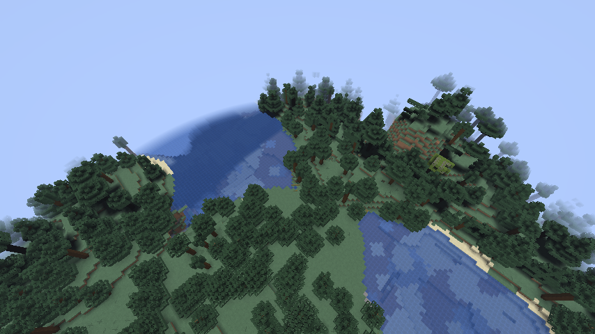
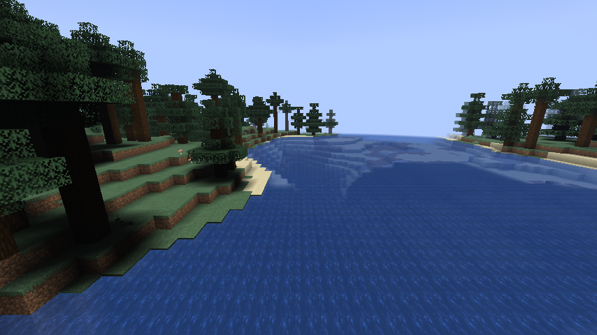
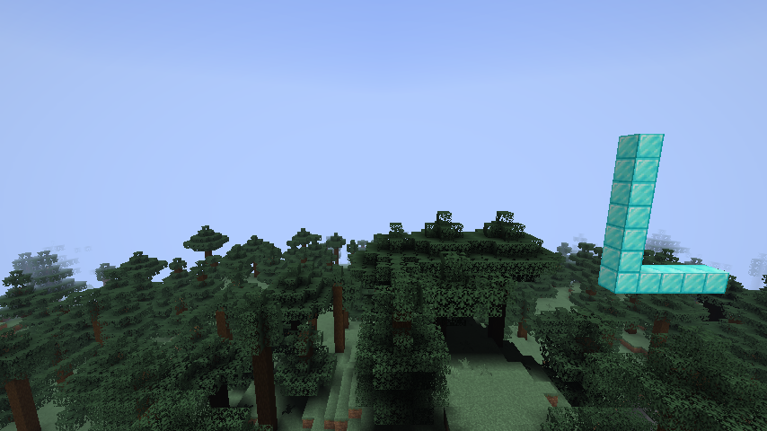

# Wraparound

> [!WARNING]
> **AI slop notice:** this mod was written almost entirely by an AI (Claude) in one sitting, out of spite. It passes its own tests and works in the cases shown below, but no human has read every line or played it for long. Expect bugs, back up your worlds, and don't use it on a server you care about.

A Fabric mod for Minecraft 26.3 that glues the edges of the world together.



- **Cylinder**: east and west are glued; north and south go on forever.
- **Torus**: both directions loop.
- **Klein bottle**: east and west loop; crossing north or south mirrors the world left to right.

There is no wall and no teleport flash. You see straight across every seam, and terrain is generated to line up on both sides.

| Looking east at a torus seam (24 blocks ahead) | A diamond L built at the north edge, seen mirrored across a Klein bottle seam |
| --- | --- |
|  |  |

## Using it

Install Fabric Loader 0.20.1+ and Fabric API, then put `wraparound-1.0.0.jar` in `mods/` (on the server and on every client).

Create a new world, open **More → Game Rules → Miscellaneous** and set:

- `wraparound:world_shape`: `flat`, `cylinder`, `torus` or `klein_bottle`
- `wraparound:world_radius`: half the width of the world in blocks (rounded down to a multiple of 16)

Pick these when you create the world. Terrain is generated for the chosen shape, so changing it later leaves cliffs where old and new terrain meet. Only the overworld wraps. A small radius (64 to 128) lets you see the world repeat in the distance.

## How it works

- The server keeps everything in the square `-radius ≤ x, z < radius`. Anything that walks out is moved back in at the matching spot (mirrored for the Klein bottle).
- Each client lives in the unrolled world. Chunks are copied to every place they appear within view, so you never jump at a seam. The server translates coordinates per player.
- Terrain noise is cross-faded near the edges so it matches whatever is on the other side.

## Known gaps

- Mobs see, chase, path to, hit and shoot at you across seams (skeletons, strays, pillagers, witches, blazes, ghasts, drowned, snow golems, llamas). Ranged attacks from mobs added by other mods may still aim the long way round.
- Trees, villages and other structures can be cut off where they cross a seam.
- A real projective plane (both seams mirrored) can't be made flat, so it isn't offered.

## Building and testing

```
./gradlew build                 # jar in build/libs, runs unit tests
./gradlew runClientGameTest     # starts the game, checks seams, saves screenshots
```
